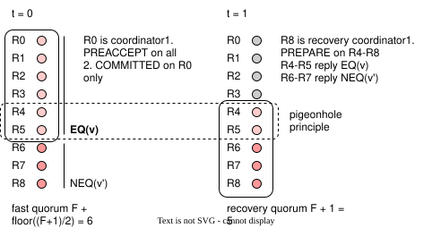
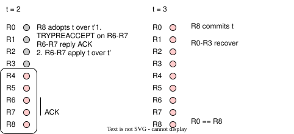

+++
title = 'EPaxos and decentralized conflict resolution'
date = 2026-11-12T00:00:00Z
draft = false
description = 'How does decentralized consensus work?'
summary = 'How does decentralized consensus work?'
tags = ['databases']
+++

Most production database systems use leader-based protocols for linearizability. But leaderless protocols are gaining popularity, like Tencent PaxosStore and the upcoming Cassandra 6.

I decided to check out one of the originals, EPaxos[^1], to get a deeper sense of how it works.

# The sequencing problem

Leader-based sequencing during normal operation is generally straightforward, its role is to assign unique incrementing (epoch, ballot) numbers to every request. This provides a performance benefit as well as simplifying the log. If there's two requests that modify the same entries, the leader arbitrates an ordering and broadcasts it globally.

Complications instead typically show up in the recovery protocol. It's not guaranteed that all replicas were able to persist the command before process failure, and the new leader can be running on a different node. The new leader must infer the state of the system with only data previously persisted by the cluster: epoch, seq, and the log itself.

The core observation of EPaxos is that if two requests aren't touching the same data, they're commutative and can be run in any order. Instead, track the conflicting requests as part of a dependency graph, and as long as you can keep that graph consistent everywhere, you can control the execution order and guarantee consistency.

# How is the ordering modeled?

Starting with the conceptual model, keys are the base unit of conflict. If there were 3 requests `[req_a, req_b, req_c]`, where `req_a = write(x, z), req_b = write(z), req_c = write(x, y, z)`, there are two key-level dependencies throughout the requests: x and z.

Dependencies are determined first: for every key, a node will record the last request and its proposer to have modified it, denoted as `conflicts[replica][key] = request`. For `req_c`, assuming the prior two requests were ordered first, will see that `conflicts[replica]["x"] = 0` and `conflicts[replica]["z"] = 1`. This means that `req_c` can wait for all requests, up to and including 1, to be executed first.

Each replica has their own view of what the dependencies are. In this scenario, if we assume that both `req_a/req_b` are started from the same replica R0, another replica R2 will see this after `req_b`:
```go
conflicts[R1]["x"] = 0
conflicts[R1]["z"] = 1
deps=[1, -1, -1]
```

If we modify it to `req_a/req_b` being separately coordinated by R0 and R1 respectively, we can see how the conflict and deps table encode the fact that we now have to wait for both R0 and R1.
```go
conflicts[R1]["x"] = 0
conflicts[R1]["z"] = 0
conflicts[R2]["z"] = 0
deps=[0, 0, -1]
```

Sequence numbering also helps to define order between conflicting requests. It is increased on:
* Creating a new proposal
* Receiving a new proposal, where a previously seen conflicting request has higher `seq`
  * Set to `max(conflicting, incoming) + 1`

Similar to dependencies, each replica tracks it per key: `maxSeqPerKey[key] = seq`, which is used in both cases. Requests take the maxes over all its keys and replies the merged value back. Given the non-uniqueness however, this is not a perfect tiebreaker as we'll see later.

Using the case where `req_a/req_b` are separately coordinated by R1 and R2, we get this sequence:


Note that this ordering preaccept stage is NOT agreement based like the commit stages are. Even though it needs a quorum of responses, this doesn't imply any kind of agreement between them yet. Replies are tentative and it's expected that they may be overwritten. The coordinator's merging of deps/seq determines the value to agree on does that

Once ordering is determined and written to stable storage, the coordinator collects these tentative `PreAccept` views provided by each member and merges them, so that the max set of dependencies are included together. Then it follows the Paxos `Accept/Commit` rounds to replicate the merged deps/seq. This is the "slow path".
```
seq = max(all seqs from replies)
deps = union(all deps from replies)
```


Alternatively, if the cluster's responses unanimously replied with identical deps/seq, it indicates portions of the cluster did not have unique information that would cause other replicas to disagree. The coordinator can skip the accept round and proceed straight to committing. This is known as the "fast path" and is unique to EPaxos.

There's one special case to mention. Say that there's two concurrent requests,
* N = 3
* Request R0.0 is proposed by R0, sent to R1,R2
* Request R1.0 is proposed by R1, sent to R0,R2
* Both requests write the same key
* R2 is unable to reply to either due to network issues

At R1, when R0.0 is processed, R1 already has R1.0 for the same key and updates R0.0, replying with:
 ```text
R0.0 = (seq=1, deps=[-1, 0, -1])
 ```
At R0, when R1.0 is processed, R0 already has R0.0 for the same key and updates R1.0, replying with:
 ```text
R1.0 = (seq=1, deps=[0, -1, -1])
```

At both R0/R1, the merged dependencies will appear to be:
```text
R0.0 = (seq=1, deps=[-1, 0, -1])
R1.0 = (seq=1, deps=[0, -1, -1])
```

Cycle! The sequence number is also equal with only 1 other conflicting event in both cases. The paper does acknowledge that it's possible for both deps/seq to be exactly equal, in which case the executor can choose to apply another arbitrary tie-breaker (that's deterministic and identical at every replica).

# How does the execution and recovery work?

Now that the pipeline is defined, the executor can use their `deps` and be topologically sorted into SCCs. Within each, they are then further sorted using the `seq` value for a linear order of commands to be run. This means dependencies have a higher precedence than sequences.

Two complications in the following execution are that,

**1.** Requests going through the stages of `PREACCEPTED -> ACCEPTED -> COMMITTED -> EXECUTED` can have their tentative deps/seq values be overridden up until the point it's committed. To handle this, the implementation must busywait on dependencies until they are also committed, guaranteeing the dep/seq sorting is computed on the final committed versions to execute on.

**2.** The execution can lag behind the ordering processes, which may happen if a coordinator fails midway through. A request may be busywaiting on a dependency stuck on `PREACCEPTED` with no sign of progress...

If a process has been waiting on a dependency for too long, it can attempt a recovery of the dependency. From this POV, its goal is to ask all peers about their last known status of the request, and see how much progress was made to infer what to do next.


It first increments the Paxos ballot number to indicate a new recovery, and sends out Prepare messages. It'll receive back replies about the last known status of this request.

If in the replies there's:
* **a commit,**
  * It means an accept quorum, or fast path preaccept quorum, had been completed before.
  * Continue running commit to remaining replicas.
* **an accept,**
  * It means a preaccept quorum had been completed before.
  * Continue running accept to remaining replicas.
* **5/9 identical preaccepts**, including itself,
  * It can continue with accept regardless of what the remaining 4/9 replicas hold, establishing a new majority agreement.
* **any preaccepts,**
  * It attempts to take it into account by rerunning the whole preaccept stage to redo the ordering calculation.
* **nothing,**
  * The request is abandoned. Broadcast a no-op and retry.

Thus the recovery algorithm is to walk in reverse order through the "checkpoints". The pseudocode ends looking like this:
```python
    # after receiving R Prepare replies from a majority
    if R contains Commit(seq, deps):
        Run Commit phase
    elif R contains Accept(seq, deps):
        Run Accept phase
    elif R contains floor(N/2) identical PreAccept(seq, deps):
        # simple majority is enough to prove safety
        Run Accept phase
    elif R contains any PreAccept(seq, deps):
	    Run PreAccept(seq, deps)
    else:
        Broadcast No-Op and retry
```

# Can we optimize the fast path quorum?

The paper then describes an optimization to reduce the fast quorum size from a unanimous `2F` to a lower latency `F + floor((F+1)/2)`.

To see how this changes the algorithm, the questions to ask are:
* On recovery, will it always reach the same conclusion as the original fast quorum, even with an impartial or different view?
* On recovery, if there has been time drift, is recalculating deps/seq safe considering it may have fast committed already?

**Case 1: Recovery quorum must reach the same conclusion as any previous fast path quorum**

One interesting detail is that the fast path quorum may continue committing even if the remaining replicas outside of `F + floor((F+1)/2)` explicitly disagree.

If the recoverer only receives preaccept replies back, it has to correctly deduce whether a fast path quorum was attempted.

To illustrate, say that we have this configuration:
* N = 9
* R0 performs `PreAccept(v)` broadcast
  * R0-R5 reply `PREACCEPT_EQ` with attributes `v`
  * R6-R8 reply `PREACCEPT` with attributes `v'` (say R7-R8 missed information previously)
* R0 performs `Commit(v)` locally through fast path
* R0-R3 stall indefinitely, `Commit(v)` not broadcasted
* R8 begins recovery process
  * R4-R8 forms recovery quorum

If R8 ends up committing `v'`, there's the risk of two diverging commits which should never happen. To avoid this, we see what the recovery quorum value `F + floor((F+1)/2)` is guaranteeing us:



The pigeonholing principle tells us that there **must** be at least an intersecting replica group `floor((F+1)/2) = 2` claiming `PREACCEPT_EQ`, present in both the fast path quorum and the recovery quorum.

If the recovery quorum sees these identical entries, it **must** try to continue the recovery using `v`, explicitly overriding its earlier `v'`. This mandatory safety step prevents R8 from split-brain committing against what was committed earlier by R0.



If it only did the normal preaccept and merge, then it may arrive at a value that isn't `v`.

**Case 2: Recovery must check validity of original context's slow/fast path decision**

Building on the previous case, it could be that on discovering the pigeonhole, the recoverer needs to deduce whether the original context for slow/fast commit has since drifted.

The `TryPreAccept` is introduced as the "recovery time reverification" round. It takes the recovery value and checks if it's safe to continue with `Accept/Commit` without modification.


Broadly, the scenario shows a recovery attempt of A by R4, failing to pass the `TryPreAccept` verifications twice. The actions of the major events can be broken down by seeing the constraints of each decision:

**1.** Recall the pigeonhole principle: for 5 replicas, the `ACK(EQ)` threshold is `floor((F+1)/2) = 1`.

Seeing the `ACK(EQ)` from R1, it means there's a possibility of a fast commit. R4 is obliged to proceed with the recovery with the prioritized value returned by R1's `ACK(EQ)`, as we saw in the case above. This means that the recovery **cannot** use `A=(6,{B})` until it's been disproven that `A=(5,{})` was fast committed.

**2.** Recall in our deps tracing that any two requests conflicting must have their deps established.

When R3 sees the proposed `A=(5,{})` the first time, it checks it against its current knowledge of all other requests: B. It notices that both of them are in flight but neither are a dependency of each other. Which it can't certify is safe, and sends back `NACK`.

Since they're both still in flight, R4's logical action is to simply wait it out. Once the information it receives changes, it can then know whether to proceed with this value or throw it away.

As a note, due to the "obliged fast path check", R3 ignores its own entry of `A=(6,{B})` because the proposer is attempting to check specifically for `A=(5,{})` in isolation.

**3.** Recall that commits still imply quorum intersections

After a long network delay, R4's reply reaches R3 which has met the criteria for performing a fast commit. This changes R3's next interpretation of `TryPreAccept` because while A is still in flight, it knows B has definitely completed first. The provided deps where neither are a dependency of each other again, make even less sense this time. It sends back `NACK` again.

R4 is able to deduce two truths now:
* A cannot have fast committed. If it did, there **must** have been some quorum intersecting replica that has either `A ∈ dep(B)` or `B ∈ dep(A))`.
* A is not **required** to continue with `A=(5,{})`, and may use any other value

Looking at the net effect, the recovery deferred the calculation of the merged A and the following accept pathway, erring on the side of correctness. Once the concrete outcome was made visible, the recovery simply retries with updated attributes by starting a new preaccept round.

Testing the alternative, if the first `NACK` had not fired then A and B would both be committed with no dependencies. The executor may see them as commutative and apply them in different orders across replicas which breaks linearizability.

The final pseudocode of our optimized recovery algorithm:

```python
    # after receiving R Prepare replies from a majority
    if R contains Commit(seq, deps):
       Run Commit phase
    elif R contains Accept(seq, deps):
       Run Accept phase
    elif R contains floor((F+1)/2) identical PreAccept(seq, deps):
       # additionally verify whether safe to continue with these existing attributes
       if TryPreAccept(seq, deps) == SUCCESS:
           Run Accept(seq, deps)
       else:
           Run PreAccept(seq, deps)
    elif R contains any PreAccept(seq, deps):
        Run PreAccept(seq, deps)
    else:
        Broadcast No-Op and retry
```

# Thoughts

The algorithm itself is really interesting. Although I did find it harder to reason about scenarios and failure modes vs. leader based protocols.

I found paper itself to be very dense, leaving unanswered questions or not elaborating on how different parts connect together. This is especially the case for the optimized recovery where it's light on the explanation, and I had to often look into the reference code[^2] or proof to answer some questions on whether a scenario is safe or unsafe.

Overall this was worth reading through. There's still much more to EPaxos, like the updated "Fixing and Simplifying Egalitarian Paxos"[^3] published in 2025, which I'll have to find time for as well.

[^1]: [There Is More Consensus in Egalitarian Parliaments. Iulian Moraru, David G. Andersen, Michael Kaminsky. 2013](https://www.cs.cmu.edu/~dga/papers/epaxos-sosp2013.pdf)
[^2]: [Github: Reference EPaxos implementation](https://github.com/efficient/epaxos)
[^3]: [Fixing and Simplifying
Egalitarian Paxos (Extended Version). Fedor Ryabinin, Alexey Gotsman, Pierre Sutra. 2025](https://arxiv.org/pdf/2511.02743v1)
