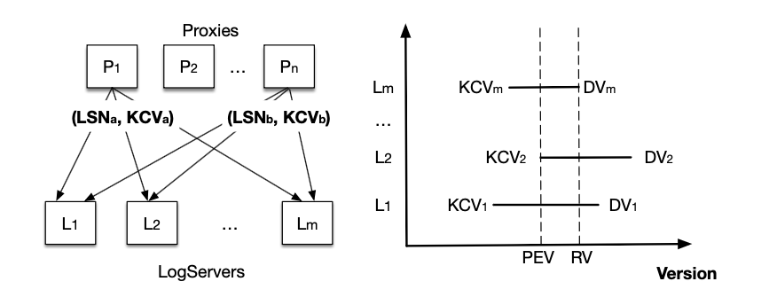

+++
title = 'FoundationDB whitepaper and tracing versionstamps'
date = 2026-11-16T00:00:00Z
draft = false
description = 'Notes from a concurrency view'
summary = 'Notes from a concurrency view'
tags = ['databases']
+++

When I was operating FDB clusters, I learned quickly why everyone at the time was so excited about it. It's still one of my favorite databases.

I had a lot of questions after reading the paper[^1] initially about the version assignment and how it gets processed throughout the system. What do you mean the log isn't quorum based? What's the recovery procedure like then? And why is there downtime for log failures? I figured it's worth a high level view of how the versions are processed throughout the system.

# The magic of RAM

The breakthrough is FDB's separation of sequencing, conflict resolution, and durability, which previously was a headache for algorithms to sort out on recovery.

The sequencer is a purely in-memory role that is elected by the cluster. Its job in the request pipeline is to assign version numbers and nothing else, at a rate of roughly 1 million versions/second.

The resolvers receive the transactions next. They keep the last 5s worth of mutation data in-memory to reject conflicting transactions. This means the entire process of ordering and resolving conflicts happens entirely in-memory.

Once the resolver is done, the logs do still need to make it durable. But it's able to do so efficiently because an entire batch of commits can be blindly appended. As a tradeoff, the memory only model means in-flight transactions can pile up which the 5s MVCC helps prevent.

# How does the logging and recovery work?

Starting with the logging system, proxy servers fan out to **all** logs in behalf of the client. Every individual log returns their committed version, and the proxy keeps track of the `KCV/KnownCommittedValue` as a watermark of where all logs have persisted the transaction.

Using individual proxy `KCV`s, we can take the max of them and that'll be the highest commited version recorded across the cluster. We call it `PEV`

With this process, we define three intervals:
1. `<= PEV` where it is _known_ that all logs have persisted the version
2. `(PEV, RV]` where it is _unknown_ that all logs have persisted the version
3. `> RV` where not all logs have persisted the version



On log server failure, the new controller might not be able to confirm whether that particular log server has made the range `(PEV, RV]` durable. All it knows is the `PEV` from the proxies, and the `RV` where it knows it's not fully committed.

This range is replayed to ensure that the new set of logs are consistent with each other. Anything above `RV` is discarded because they were never committed.

The flipside is that any log failure triggers a full recovery. Since the logs only contain 5s of MVCC, the rationale is that this is fairly cheap and is the easiest solution (vs. dealing with the backpressure dynamically, I'd imagine). The recovery time in Figure 10 averages about a few seconds which the client is assumed to be able to absorb. One of the developers frames it this way,[^6]

> I personally view the tradeoff as FDB gives you 99.95% availability and you pay for 3 replicas per shard. Raft gives you 99.99% availability and you pay for 5 replicas per shard.

One caveat worth mentioning is how in-flight transactions are handled. Write transactions on commit cannot get a final commit version, so they must be canceled. For read transactions, there's this statement in the paper:

> However, client reads were not impacted, because they are served by StorageServers.

Assuming storage servers are still up, this is true for snapshot reads but new ones will be unable to retrieve a read version.

# What about dirty reads?

It's not explicitly stated how transactions above DV are executed, and the question of dirty reads can come up given:

1. Recovery process can discard transactions above DV as they're not considered committed.
2. Read-only transaction commits are effectively a client no-op

If there are write transactions above DV, and you have a higher versioned read transaction, would that imply the possibility of dirty reads?

FDB prevents this by having the storage servers block these read requests until all transactions before it are committed first. They reach out to log servers to peek at what it's view of the commit version is. This is also described by the developers on the forum:[^2]

> "The storage server won't persist data that will be rolled back later [...] when peeking data from transaction logs, the TLogPeekReply message contains a minKnownCommittedVersion field, which essentially means any version before or equal to this number has been persisted on 3 logs, thus having no chance of rolling back during recovery"

# How does it store its own internal metadata?

The way FDB stores data for its own internal functions deserves a mention. Many of the cluster operations have to be written somewhere in case they fail, like node exclusion, and FDB doesn't rely on external storage for anything other than backups.

**Special keys** are instead a reserved part of the keyrange that's prefixed with `\xff`. It holds everything from the shard mappings, to temporary operational states, to tenant info.

This lets the internal metadata be versioned by the same sequencing as user requests, and not have to worry about consistency itself. Information like the shards being able to be retrieved in a normal way under `\xff/keyServers/...` is also nice for tooling since not everything is published in places like the status JSON.

**Coordinators** are the main exception because it's below the transaction layer in the stack. They form a Paxos group and decide on cluster metadata things like membership and log topology, which are used before starting the transaction system or the sequencer.

# What is the transaction lifecycle in the client?

While the server handles much of the version mechanics, the rest of the transaction is stored inside the client.

Conceptually, the resolvers only need to know the compiled list of operations at the commit, the order of ops within a transaction don't matter. This means the client can buffer the entire transaction into memory and send it all at once during the commit.

The reduced transaction state looks like this, most of which is used at the commit stage.
```cpp
struct NativeTransaction {
     Future<Version> readVersionFuture,             // GRV fetch at transaction start: getReadVersion()
     Version committedVersion = invalidVersion;     // determined after successful commit

     VectorRef<MutationRef> mutations               // set / clear / clearRange / atomicOp
     VectorRef<KeyRangeRef> read_conflict_ranges    // reads, addReadConflictRange
     VectorRef<KeyRangeRef> write_conflict_ranges   // writes, addWriteConflictRange
};
```

Aside from `addWriteConflictRange`, it's generally true that the values in `mutation/write_conflict_ranges` will be similar. The separation is likely an optimization for the resolvers, since from its perspective any keyranges being modified is a conflict, not sending over the value can save a lot of memory.

Over the span of the transaction, the client running the closure still needs to apply RYW semantics, including fetching existing data from the datastore. A RYW wrapper handles the read/writes by automatically applying `WriteMap` on top of `SnapshotCache` when read by the client, and embeds the native transaction for the overall versioning above.

```cpp
struct RYWTransaction {
     Transaction tr;            // as seen above (mostly empty until RYW flushes at commit)

     SnapshotCache   cache;     // remote read results
     WriteMap        writes;    // current state map
};
```

When it's time to commit, the `WriteMap` is ported over to the `NativeTransaction`, as a mutation map and the write conflict ranges. The `SnapshotCache` is then deallocated, or reset in case of a retry.

# How do retries work?

On transaction start, the read version is assigned by the server and saved in the client for the rest of the transaction. What does it then do for retries?

The Python API[^3] makes it look like it reuses the same transaction handle, it's not unreasonable to look at it and think it's reusing the same version.

```python
tr = db.create_transaction()
while True:
    try:
        simple_function(tr, 'a', 'b')
        tr.commit().wait()
        break
    except fdb.FDBError as e:
        tr.on_error(e).wait()
```

Instead, when an error occurs, the `on_error` forwards the error code from the bindings into the client core. Then it'll reset the internal transaction state without invalidating the handler's pointer to it. This prevents the language bindings from implementing the state reset individually, or bubbling up retry mechanics into user logic. It also explains why `SnapshotCache` is reset, since the data was for the previous transaction's version.

In version 8.0 the part that resets the read version looks like this:[^4]

```cpp
Reference<TransactionState> TransactionState::cloneAndReset(...) const {
    newState->readVersionFuture = Future<Version>();  // Gets updated read version by server
}
```

[^1]: [FoundationDB: A Distributed Unbundled Transactional Key
Value Store. 2021](https://www.foundationdb.org/files/fdb-paper.pdf)
[^2]: [FoundationDB Forums: Is it possible that the aborted transaction is persistent in SS?](https://forums.foundationdb.org/t/is-it-possible-that-the-aborted-transaction-is-persistent-in-ss/3193)
[^3]: [FoundationDB Python API: Transactional decoration](https://apple.github.io/foundationdb/api-python.html#transactional-decoration)
[^4]: [NativeAPI.cpp#L1542-L1560](https://github.com/apple/foundationdb/blob/bf64ce35c6b1ddec9acc281c8a1e5c62bfe4e0cb/fdbclient/NativeAPI.cpp#L1542-L1560)
[^5]: https://forums.foundationdb.org/t/possibility-of-stale-reads/3259
[^6]: [FoundationDB Forums: Write-availability of FoundationDB](https://forums.foundationdb.org/t/write-availability-of-foundationdb/2668/5)
